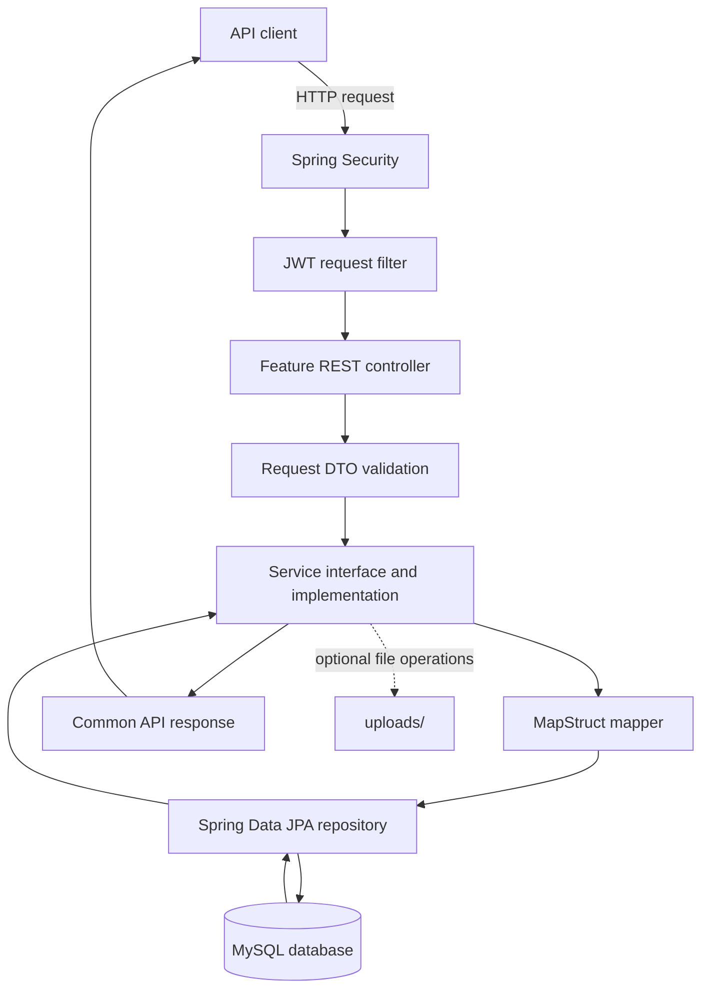

# Invoice Management System

Backend REST API for managing invoices and related business records. The application is built with Java 17, Spring Boot, Spring Security, Spring Data JPA, and MySQL.

## Project structure

```text
invoiceManagementSystem/
├── .mvn/
│   └── wrapper/
│       └── maven-wrapper.properties
├── src/
│   ├── main/
│   │   ├── java/com/ims/
│   │   │   ├── InvoiceManagementSystemApplication.java
│   │   │   ├── common/                 # Shared API and pagination responses/utilities
│   │   │   ├── config/                  # Spring, security, CORS, web and data setup
│   │   │   ├── controller/              # REST endpoints grouped by feature
│   │   │   │   ├── auth/
│   │   │   │   ├── bankAccount/
│   │   │   │   ├── category/
│   │   │   │   ├── company/
│   │   │   │   ├── customer/
│   │   │   │   ├── invoice/
│   │   │   │   ├── party/
│   │   │   │   ├── permission/
│   │   │   │   ├── product/
│   │   │   │   ├── profile/
│   │   │   │   ├── role/
│   │   │   │   ├── sizes/
│   │   │   │   ├── subCategory/
│   │   │   │   ├── taxMaster/
│   │   │   │   ├── units/
│   │   │   │   └── user/
│   │   │   ├── dtos/                   # Request and response types, grouped by feature
│   │   │   ├── entity/                 # JPA entities
│   │   │   ├── enums/
│   │   │   ├── exception/              # Domain exceptions and global exception handler
│   │   │   ├── filter/                 # Request filters, including JWT authentication
│   │   │   ├── mapper/                 # MapStruct mappers grouped by feature
│   │   │   ├── repository/             # Spring Data repositories
│   │   │   │   └── permission/
│   │   │   ├── service/
│   │   │   │   ├── impl/               # Business logic implementations
│   │   │   │   └── serviceInterface/   # Service contracts
│   │   │   └── utils/
│   │   │       ├── apiConstants/
│   │   │       ├── base/
│   │   │       ├── jwt/
│   │   │       ├── specification/
│   │   │       └── validation/
│   │   └── resources/
│   │       └── application.properties  # Application, database and integration settings
│   └── test/
│       └── java/com/ims/
│           └── InvoiceManagementSystemApplicationTests.java
├── uploads/                            # Runtime file uploads (products, company logos/signatures)
├── .gitignore
├── HELP.md
├── mvnw
├── mvnw.cmd
└── pom.xml
```

### Key folders and file names

The following paths are relative to `src/main/java/com/ims/`. Feature packages contain the classes named below; DTO and mapper packages follow the same feature-based organization.

```text
InvoiceManagementSystemApplication.java
common/
├── ApiResponse.java
├── PageResponse.java
├── PageUtil.java
└── SpringContext.java
config/
├── CorsConfig.java
├── CurrentSession.java
├── DataInitializer.java
├── SecurityConfig.java
└── WebConfig.java
controller/
├── auth/AuthController.java
├── bankAccount/BankAccountController.java
├── category/CategoryController.java
├── company/CompanyController.java
├── customer/CustomerController.java
├── invoice/InvoiceController.java
├── party/PartyController.java
├── permission/
│   ├── ActionController.java
│   ├── ModuleActionController.java
│   ├── ModuleController.java
│   ├── RolePermissionController.java
│   └── UserPermissionController.java
├── product/ProductController.java
├── profile/ProfileController.java
├── role/RoleController.java
├── sizes/SizeController.java
├── subCategory/SubCategoryController.java
├── taxMaster/TaxMasterController.java
├── units/UnitController.java
└── user/UserController.java
dtos/
├── auth/
│   ├── AuthRequest.java
│   └── AuthResponse.java
├── invoice/
│   ├── InvoiceCreateRequest.java
│   ├── InvoiceItemRequest.java
│   ├── InvoiceItemResponse.java
│   ├── InvoiceResponse.java
│   ├── InvoiceSearchRequest.java
│   └── InvoiceUpdateRequest.java
└── [other feature packages: request and response DTOs]
entity/
├── BaseEntity.java
├── InvoiceEntity.java
├── InvoiceItemEntity.java
├── InvoiceSequenceEntity.java
├── ProductEntity.java
├── UserEntity.java
└── [other JPA entity classes]
exception/
├── GlobalExceptionHandler.java
├── ResourceNotFoundException.java
├── ValidationException.java
└── [other domain exception classes]
filter/
└── JwtRequestFilter.java
mapper/invoice/
├── InvoiceItemMapper.java
└── InvoiceMapper.java
repository/
├── InvoiceItemRepository.java
├── InvoiceRepository.java
├── InvoiceSequenceRepository.java
└── [other feature repositories]
service/
├── impl/invoice/
│   ├── InvoiceNumberServiceImpl.java
│   └── InvoiceServiceImpl.java
└── serviceInterface/invoice/
    ├── InvoiceNumberService.java
    └── InvoiceService.java
utils/
├── jwt/JwtUtil.java
├── specification/InvoiceSpecification.java
└── validation/InvoiceValidation.java
```

Application resources and project-level files:

```text
src/main/resources/application.properties
src/test/java/com/ims/InvoiceManagementSystemApplicationTests.java
.mvn/wrapper/maven-wrapper.properties
.gitignore
HELP.md
mvnw
mvnw.cmd
pom.xml
```

## Request and data flow



For sign-in, the authentication endpoint validates credentials and returns an authentication response containing a JWT. Subsequent protected requests include the token for the JWT filter to validate before the controller is invoked.

## Technology stack

- Java 17
- Spring Boot 4
- Spring Web, Spring Security, Spring Data JPA, and Bean Validation
- MySQL
- JWT (JJWT)
- MapStruct and Lombok
- Springdoc OpenAPI / Swagger UI
- Maven Wrapper

## Run locally

1. Install a compatible JDK 17 and ensure MySQL is available.
2. Configure the database connection and any mail/JWT settings in `src/main/resources/application.properties`. Keep local credentials and signing secrets private.
3. Start the application from the project root:

   ```powershell
   .\mvnw.cmd spring-boot:run
   ```

The configured server port is `8081`, and the API context path is `/api/v1.0`. Swagger UI is configured at `/api/v1.0/swagger-ui.html`.

To build the project:

```powershell
.\mvnw.cmd clean package
```
